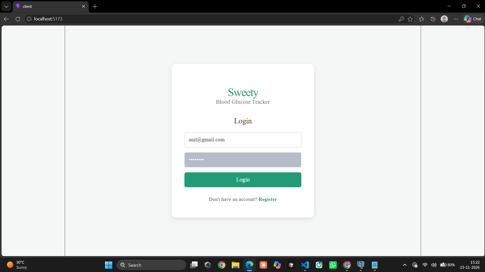
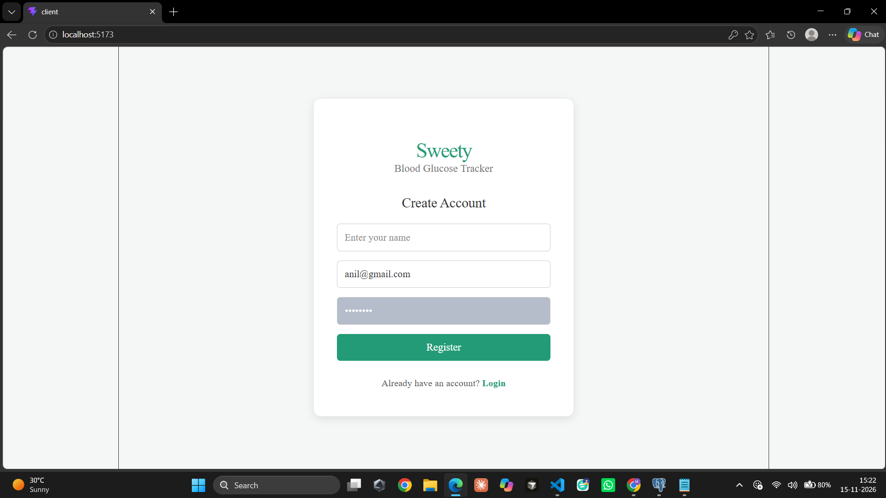
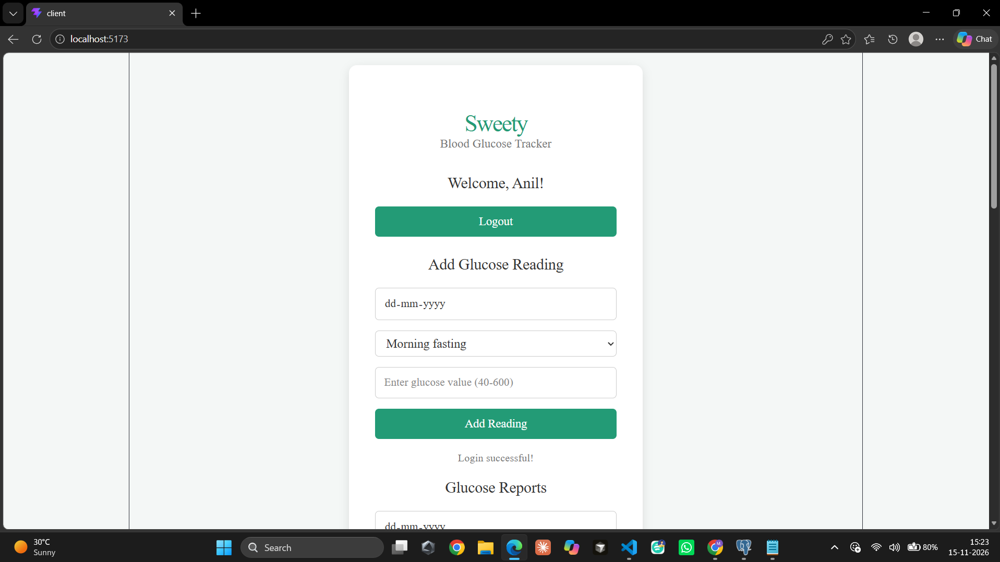
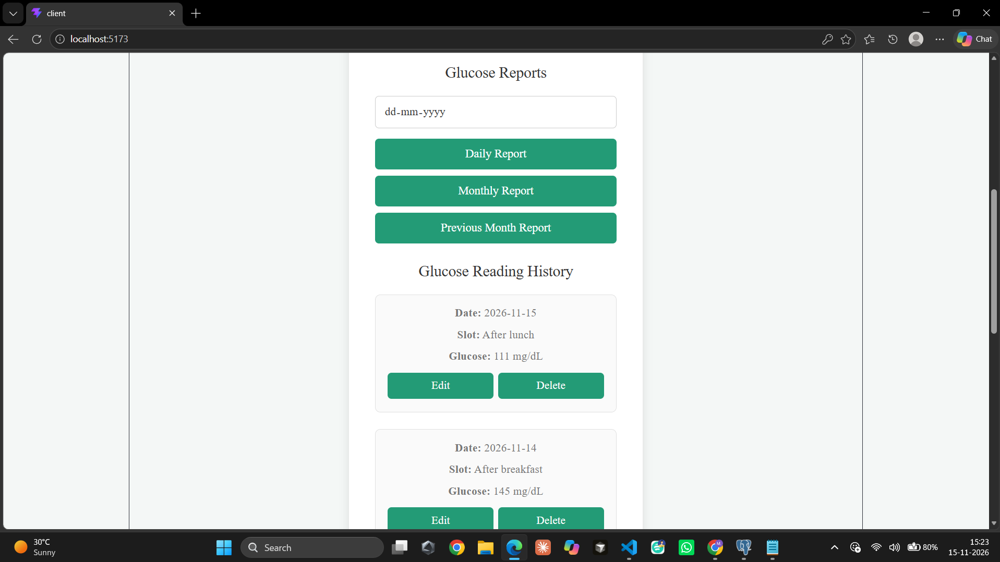
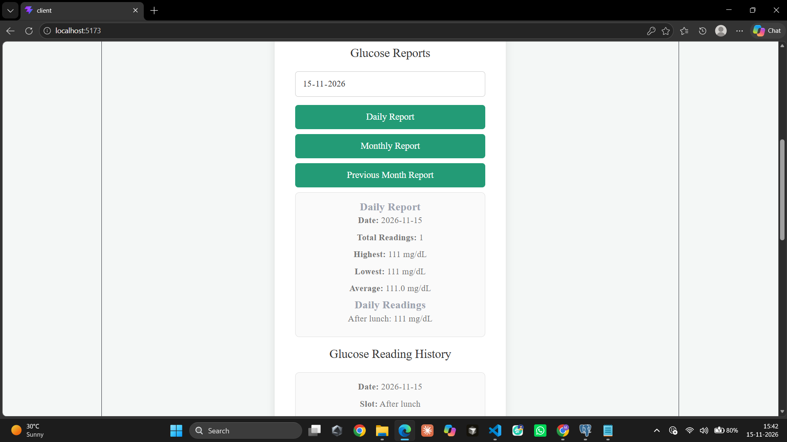

# Sweety – Blood Glucose Tracker

A full-stack web application that allows users to securely record, manage, and monitor their blood glucose readings.

## Features

- User registration and login with JWT authentication
- Secure password hashing using bcrypt
- Add, view, edit, and delete glucose readings
- Four reading slots:
  - Morning fasting
  - After breakfast
  - After lunch
  - After dinner
- Daily glucose reports
- Monthly glucose reports
- Previous month reports
- Summary statistics: highest, lowest, average, and total readings
- User-specific data access and protection
- Responsive React interface

## Technology Stack

**Frontend**
- React.js
- Vite
- Axios
- CSS

**Backend**
- Node.js
- Express.js
- PostgreSQL
- JWT
- bcrypt

## Project Structure

```text
Sweety/
├── client/
│   ├── src/
│   │   ├── components/
│   │   ├── hooks/
│   │   ├── services/
│   │   ├── App.jsx
│   │   └── main.jsx
│   └── package.json
├── server/
│   ├── middleware/
│   ├── routes/
│   ├── db.js
│   ├── index.js
│   ├── seed.js
│   ├── package.json
│   └── .env.example
└── README.md
```

## Prerequisites

- Node.js and npm
- PostgreSQL

## Installation and Setup

### 1. Clone the repository

```bash
git clone YOUR_GITHUB_REPOSITORY_URL
cd Sweety
```

### 2. Database Setup

Create a PostgreSQL database named `sweety_db`.

Create the following tables:

```sql
CREATE TABLE users (
    id SERIAL PRIMARY KEY,
    name VARCHAR(100) NOT NULL,
    email VARCHAR(150) UNIQUE NOT NULL,
    password_hash VARCHAR(255) NOT NULL,
    created_at TIMESTAMP DEFAULT CURRENT_TIMESTAMP
);

CREATE TABLE glucose_readings (
    id SERIAL PRIMARY KEY,
    user_id INTEGER NOT NULL REFERENCES users(id) ON DELETE CASCADE,
    reading_date DATE NOT NULL,
    slot VARCHAR(30) NOT NULL,
    glucose_value INTEGER NOT NULL,
    created_at TIMESTAMP DEFAULT CURRENT_TIMESTAMP,
    CONSTRAINT valid_slot CHECK (
        slot IN (
            'Morning fasting',
            'After breakfast',
            'After lunch',
            'After dinner'
        )
    ),
    CONSTRAINT valid_glucose_value CHECK (
        glucose_value BETWEEN 40 AND 600
    ),
    CONSTRAINT unique_user_date_slot UNIQUE (
        user_id,
        reading_date,
        slot
    )
);
```

### 3. Backend Setup

```bash
cd server
npm install
```

Create a `.env` file using `.env.example` and configure your PostgreSQL credentials and JWT secret.

Start the backend:

```bash
node index.js
```

Backend runs at:

`http://localhost:5000`

### 4. Frontend Setup

Open another terminal:

```bash
cd client
npm install
npm run dev
```

Open the local URL displayed by Vite, usually:

`http://localhost:5173`

## API Endpoints

| Method | Endpoint | Description |
|---|---|---|
| POST | `/api/auth/register` | Register a user |
| POST | `/api/auth/login` | Login |
| POST | `/api/readings` | Add a reading |
| GET | `/api/readings` | Get readings |
| PUT | `/api/readings/:id` | Update a reading |
| DELETE | `/api/readings/:id` | Delete a reading |
| GET | `/api/reports/daily?date=YYYY-MM-DD` | Daily report |
| GET | `/api/reports/monthly` | Current month report |
| GET | `/api/reports/previous-month` | Previous month report |

Protected endpoints require a valid JWT Bearer token.

## Validation and Security

- Passwords are hashed using bcrypt.
- JWT authentication protects private API endpoints.
- Users can access only their own glucose readings.
- Glucose values must be between 40 and 600.
- Future reading dates are rejected.
- Duplicate reading slots for the same date and user are prevented.


## Sample Data

To create a demo user and insert sample glucose readings, run these commands from the server directory:

```bash
node seed.js demo@example.com your_demo_password
```

This script:
- Creates a demo user if the email does not already exist.
- Hashes the password using bcrypt.
- Inserts four sample glucose readings.
- Avoids duplicate readings when run again.


## Screenshots

### Login Page


### Register Page


### Dashboard


### Glucose Reading History


### Glucose Reports



## Notes

### Assumptions
- Each user can access only their own glucose readings.
- A user can add a maximum of four readings per day, one for each time slot.
- Glucose values must be whole numbers between 40 and 600 mg/dL.
- Future dates are not allowed for glucose readings.
- Monthly Report displays readings from the first day of the current month up to the selected date.
- Previous Month Report displays readings for the entire previous calendar month.

### Future Improvements
- Add interactive charts to visualize glucose trends.
- Implement pagination for reading history.
- Add automated backend and frontend tests.
- Improve deployment and production configuration.
- Add a doctor role to allow authorized healthcare professionals to view patient reports.

## Author

M. Anil

B.Tech – Computer Science and Engineering